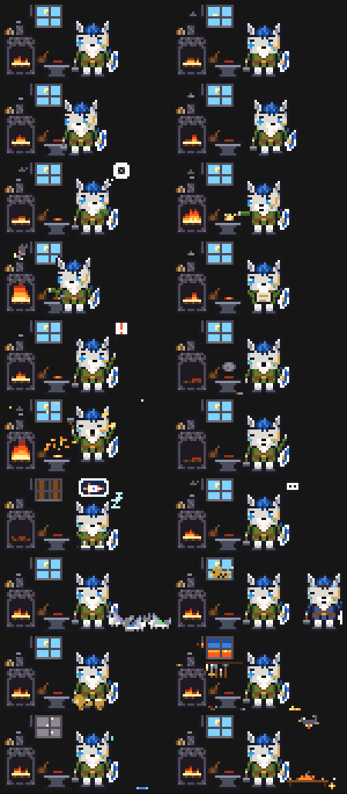

# Diorama

Un petit monde en pixel art qui vit au-dessus du prompt de chaque session de Claude Code, dans
[ClaudeTerminal](https://github.com/scorpheus/ClaudeTerminal). Le personnage suit le travail de Claude :
il réfléchit quand le modèle réfléchit, se met à l'ouvrage quand un outil tourne, éprouve les tests,
scelle les commits, attend la personne quand Claude a une question et fait la sieste après dix minutes
de calme. Les sous-agents arrivent en petites créatures, les sessions se rendent visite.



Ce dépôt garde **le dessin** : ClaudeTerminal compile la forge telle quelle depuis ce dossier (son
`build.rs`, `DIORAMA_DIR`, sinon `../Diorama`) et la peint au vrai pixel de l'écran. Le moteur qui suit
les sessions (le « cerveau ») vit dans ClaudeTerminal (`src/cerveau/`). L'ancien mod de Claude Code
(les hooks, l'appli de rendu par-dessus le terminal, le passeur, les thèmes JSON) a été retiré le
15 novembre 2026 ; l'historique le garde jusqu'au commit `2fa375b`.

## Ce qu'il y a

| dossier | rôle |
|---|---|
| `rendu/src/forge/` | la forge : l'atelier, la cour, la baie, le ciel, les bêtes, le personnage (`pet.rs`) |
| `rendu/src/scene.rs` | le contrat entre la forge et celui qui la peint (`Image`, `Scene`) |
| `rendu/pet/` | les planches du personnage et de ses accessoires (`.webp`, lues à la compilation) |
| `rendu/src/main.rs`, `vitrine.rs` | les outils pour regarder la forge sans ClaudeTerminal |
| `habitants/` | les habitants des onglets de ClaudeTerminal, un JSON chacun (contrat : `habitants/LISEZMOI.md`) |
| `tools/habitants/` | dessiner, vérifier et ranger les habitants |
| `tools/pet/` | refaire les planches du personnage (`tools/pet/CHATGPT.md`) |
| `tools/route-du-rhum*.mts` | la Route du Rhum : désigner la séance, relever le pointage |

## Regarder la forge

Dans `rendu/` :

```
cargo run --release -- --planche planche.png [--large <colonnes>]   chaque moment, sur une planche PNG
cargo run --release -- --galadriel <dossier> [--large <colonnes>]   Galadriel dans chaque moment
cargo run --release -- --vitrine                                    les moments joués dans une fenêtre
cargo test
```

Dans la vitrine : ← → change de moment, espace met en pause, R reprend le moment, C change la cape,
A l'accessoire. Une fois la forge changée, recompiler ClaudeTerminal l'embarque.

## La Route du Rhum

Pour la Route du Rhum 2026 (départ de Saint-Malo le dimanche 1er novembre à 13h02), une séance de
ClaudeTerminal, et une seule, voit la cour de la forge devenir la mer : la flotte, le voyage de
Saint-Malo à la Guadeloupe, le ciel de l'heure, la carte de l'Atlantique, le départ et les arrivées
fêtés. La forge la dessine (`rendu/src/forge/baie.rs`, `trace.rs`) ; ClaudeTerminal choisit la séance
et lit le pointage (`src/cerveau/rhum.rs`).

**Quelle séance la montre** : celle que nomme la première ligne de `diorama-route-du-rhum.txt`, dans
le dossier de Claude Code (`%USERPROFILE%\.claude`, ou `CLAUDE_CONFIG_DIR`), par son pid, son nom ou
son identifiant ; ou celle dont le profil pose `DIORAMA_ROUTE_DU_RHUM=1`. L'outil la désigne :

```
node tools/route-du-rhum.mts            qui la montre, et les sessions ouvertes
node tools/route-du-rhum.mts 12345      désigne cette session
node tools/route-du-rhum.mts --aucune   plus aucune
```

**Les vraies données.** La séance désignée lit aussi `diorama-route-du-rhum.json`, à côté du fichier de désignation, dès qu'il change. Quand il est là :
- chaque bateau est à sa place sur la carte, coloré par classe, le premier de chaque classe cerclé, ceux qui ont abandonné en gris ;
- la trace du premier de chaque classe, depuis Saint-Malo ;
- quand une classe change de premier, le journal le note et le personnage le dit ;
- les bateaux de la baie prennent les couleurs du premier de leur classe ;
- le décor avance avec la distance qui reste au premier ;
- une ligne donne, à tour de rôle, le premier de chaque classe, sa distance à l'arrivée, sa vitesse et l'heure du pointage.

Ce fichier, quiconque a les données l'écrit : un script, un orchestrateur. Son format :

```json
{
  "at": "2026-11-03T13:00:00Z",
  "bateaux": [
    { "nom": "…", "skipper": "…", "classe": "Ultim", "couleurs": ["#1d3f8a", "#f2c14e"],
      "lat": 30.04, "lon": -33.97, "rang": 1, "dtf": 1771.4, "vitesse": 31.2 }
  ]
}
```

- `classe` : `Ultim`, `Ocean Fifty`, `IMOCA`, `Class40`, `Vintage Multi` ou `Vintage Mono` (`Rhum Multi` et `Rhum Mono`, leurs noms jusqu'en 2022, sont lus aussi).
- `couleurs` : la coque, puis la bande.
- `rang` : le rang dans la classe, déduit de `dtf` s'il manque.
- `dtf` : les milles jusqu'à l'arrivée.
- `vitesse` : en nœuds.
- `statut` : `RAC` en course, `ARV` arrivé, `RET` (ou `ABD`, `DNF`, `DNS`, `DSQ`) hors course. Un bateau hors course reste sur la carte, en gris, sans rang ni distance : il ne mène pas sa classe et ne fait pas avancer le décor.
- `trace` : facultative, la route parcourue, `[[lat, lon], …]` des plus anciens points au dernier. La carte dessine celle des premiers.
- Seuls `nom`, `classe`, `lat` et `lon` sont obligatoires ; un bateau sans eux est laissé de côté.

**L'outil qui l'écrit**, d'après le tracker GeoVoile de la course (`routedurhum.geovoile.com/2026/tracker/`). Les positions y arrivent chiffrées, et seul le JavaScript de la carte les décode : l'outil charge donc la carte dans Edge (ou Chrome) sans fenêtre et lit la flotte décodée en mémoire. Il n'y a rien à installer. Il écrit à côté, puis renomme.
```
node tools/route-du-rhum-suivre.mts               un pointage toutes les 15 minutes
node tools/route-du-rhum-suivre.mts --une-fois    un seul (pour une tâche planifiée)
node tools/route-du-rhum-suivre.mts --annee 2022 --instant 2022-11-12T14:00Z --sortie -
                                                  rejoue un instant de 2022, à l'écran
```
Tant que la carte 2026 n'est pas en ligne, il le dit et n'écrit rien.

**Personne n'a à le lancer** : la séance de ClaudeTerminal qui montre la course le lance elle-même, avec `--une-fois`, tous les quarts d'heure, d'une semaine avant le départ à quarante jours après. Elle le fait sans fenêtre, et tant qu'elle est ouverte.

Ce qui restait à vérifier pendant la course : [docs/route-du-rhum-a-faire.md](docs/route-du-rhum-a-faire.md).

## Licence

MIT. Voir [LICENSE](LICENSE).
