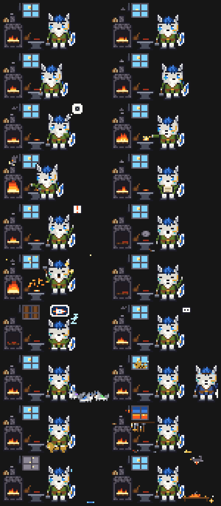
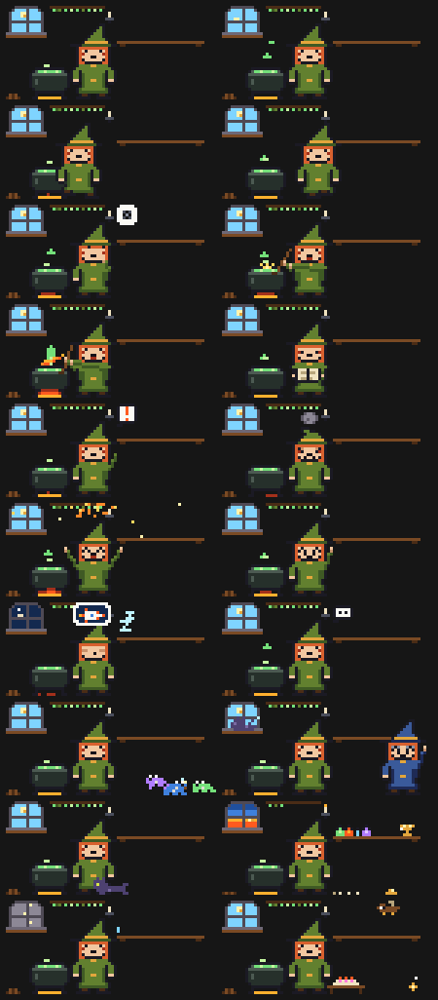

# Diorama

Un petit monde en pixel art qui vit au-dessus du prompt de Claude Code.

Un personnage suit le travail de Claude, sans qu'on ait rien à faire :
- il réfléchit quand le modèle réfléchit et se met à l'ouvrage quand un outil tourne ;
- il éprouve les tests, scelle les commits, attend la personne quand Claude a une question ;
- il fait la sieste après dix minutes de calme.

Chaque sous-agent arrive en petite créature, puis repart sa mission faite. Les sessions ouvertes sur la même machine se rendent visite et s'envoient des nouvelles, et un animal unique passe de l'une à l'autre. Sous Windows, le visiteur traverse l'écran en vol, d'une fenêtre de terminal à l'autre (voir [Le passeur](#le-passeur-windows)).

À côté de la scène s'affichent les jauges de contexte, de la fenêtre de 5 h et de celle de 7 jours, avec l'heure de leur remise à zéro. Le contexte se mesure à la fenêtre de compaction quand les réglages en fixent une (`autoCompactWindow`, ou `CLAUDE_CODE_AUTO_COMPACT_WINDOW`), sinon à celle du modèle. Il y a aussi l'expérience gagnée, ce que fait Claude en ce moment et un journal court.

| La forge (thème par défaut) | L'antre de la sorcière |
|---|---|
|  |  |

## Installation

Il faut Claude Code avec les mods (plugins de *function hooks*), et un terminal à couleurs vraies. Le mod a été testé avec la version 2.1.291, sous Windows Terminal.

```
claude plugin marketplace add scorpheus/Diorama
claude plugin install diorama@diorama
```

Ouvrez ensuite une nouvelle session : le bandeau apparaît au-dessus du prompt. Pour mettre à jour : `claude plugin update diorama@diorama`.

## Réglages (`/config`)

| réglage | valeurs |
|---|---|
| **Thème** | `forge` (par défaut), `sorciere`, ou le chemin absolu d'un `theme.json` à soi |
| **Largeur de la scène** | `auto` prend la plus large qui tient à côté du texte ; `complet`, `compact` et `seul` réduisent la scène |
| **Répliques** | `local` : des phrases toutes prêtes, sans coût ; `haiku` : Haiku écrit la réplique de fin de tour ; `aucune` : le personnage se tait |
| **Statut de la tâche** | `haiku` : Haiku résume la tâche et où elle en est ; `simple` : sans modèle ; `aucun` |

**Ce que coûte Haiku.** Avec les réglages par défaut, Haiku est appelé :
- une fois par conversation, pour choisir la tenue du personnage ;
- une fois par sous-agent, pour lui donner un nom ;
- une fois par conversation, à la première sieste, pour le rêve ;
- pour le statut de la tâche : une fois par demande, au plus une fois toutes les deux minutes de travail, et une fois en fin de tour.

Chaque appel coûte quelques centaines de jetons, sur votre compte. Pour n'en faire aucun : *Statut* `simple` ou `aucun`, et *Répliques* `local` ou `aucune`. Il restera tout de même les appels pour la tenue, le nom des aides et le rêve. Haiku reçoit le début de la conversation, des extraits de réponses et les noms des actions en cours.

## Le passeur (Windows)

Quand un personnage part en visite, le passeur le fait voler pour de vrai : il saute du bord de sa scène, traverse l'écran en arc, par-dessus les autres fenêtres, sans monter plus haut que le tiers bas de l'écran, et se pose au bord de la scène de son hôte. Au retour, il refait le chemin dans l'autre sens. C'est le personnage du thème, dans sa tenue, au quart de sa taille, qui marche en l'air. Il vole dans les couleurs de la palette, sans la lumière de la scène.

- **Lancement** : un hook `SessionStart` le démarre, caché, s'il ne tourne pas déjà. Il n'y en a qu'un par machine. C'est un petit programme compilé une fois dans `%LOCALAPPDATA%\Diorama\passeur.exe`, puis de nouveau quand `passeur/passeur.cs` change. Il s'arrête seul une minute après la fermeture de la dernière session, ou quand son code change (le lancement suivant prend la nouvelle version).
- **Ce qu'il coûte** : au repos, 0,1 à 0,3 % d'un cœur et 30 Mo de mémoire, avec une dizaine de sessions ouvertes. Il regarde la date du stockage quatre fois par seconde, et quand elle change, il n'en décode que les visites qui ont changé. Un vol coûte environ 0,3 s de processeur, réparties sur ses deux secondes.
- **Ce qu'il faut** : Windows, avec Windows PowerShell 5.1, celui de Windows, et rien d'autre à installer. Il fonctionne avec Windows Terminal et avec la console classique (conhost).
- **Quand il ne vole pas** : une session sans fenêtre (lancée en fond), une fenêtre réduite ou cachée par une autre à l'endroit de sa scène, deux sessions dans deux onglets d'une même fenêtre, ou une session qui n'affiche pas la scène (fenêtre trop étroite). La visite a lieu quand même, comme avant.
- **Ce qu'il lit**, sans rien écrire : le stockage du mod (les visites, et la scène de chaque session), et `~/.claude/sessions/` pour savoir quel processus porte quelle session. La fenêtre d'une session, il la trouve en s'attachant un instant à sa console.
- **Son journal** : `%TEMP%\diorama-passeur.log` dit chaque vol, ou pourquoi il n'a pas eu lieu.
- **La géométrie** suit les réglages par défaut de Windows Terminal : onglets dans la barre de titre, marge de 8 px, police quelconque. Avec d'autres réglages, le point de départ peut tomber à côté. Les constantes sont en tête de `passeur/passeur.cs` (classe `Places`).

Pour voir un vol sans attendre une visite : `node tools/envol.mts forge --de <session | pid> --vers <session | pid>`. Sans arguments, l'outil liste les sessions ouvertes.

## La Route du Rhum

Pour la Route du Rhum 2026 (départ de Saint-Malo le dimanche 1er novembre à 13h02), une session de la machine, et une seule, voit la cour de la forge devenir la mer. L'appli native la peint au vrai pixel de l'écran ; le dessin au terminal (`rendu` à `non`) en garde une version en gros pixels, à Saint-Malo seulement.

- **La flotte** : de petites voiles à l'horizon, des Class40 et des IMOCA (foils, gennaker au portant), un Ocean Fifty, et, si la cour est assez large, un ou deux Ultim en vol (la coque centrale hors de l'eau, le flotteur et ses foils dedans). Avant le départ, ils tirent des bords autour des bouées de la ligne ; après, ils filent vers l'Atlantique, sillage et embruns compris. La nuit, leurs feux de navigation s'allument.
- **Le voyage** : le décor suit l'avancée de la course.
  - À Saint-Malo, le quai de granit, le pavois, le phare sur son îlot, et le bateau-comité dont le canon tonne jusqu'au départ.
  - Au large, le pont de teck et ses filières, des dauphins qui sautent, une baleine qui souffle, et le Pico quand on passe les Açores ; la nuit, les sillages s'allument.
  - Aux tropiques, les cumulus des alizés, les grains et leur rideau de pluie, les poissons volants, les sargasses et les frégates.
  - En Guadeloupe, la plage, les palmiers, les mornes de Basse-Terre et la Soufrière ; la nuit, le feu d'artifice des arrivées.
- **Le ciel de l'heure** : le soleil qui se couche dans la mer et son reflet, la lune, les étoiles, les cumulus qui passent, l'orage.
- **À côté des jauges** : le compte à rebours, puis le jour de course. Au coup de canon, le personnage saute de joie et le journal le note.
- **Le spectacle du lancement** : quand une session prend la mer (à son ouverture, ou quand on la désigne), elle joue une vingtaine de secondes, dès que l'appli l'a trouvée.
  - Jusqu'aux premières arrivées, c'est **le départ rejoué** à Saint-Malo : la flotte alignée sur la ligne, le coup de canon du bateau-comité, le personnage qui saute de joie, la flotte lâchée vers le large. Avant le 1er novembre, les bateaux reviennent ensuite tirer leurs bords.
  - Ensuite, c'est **l'arrivée** à Pointe-à-Pitre : un Ultim aux couleurs du premier coupe la ligne, un feu d'artifice part, de jour comme de nuit, et un message nomme les bateaux arrivés que la machine n'a pas encore fêtés (`rhum:arrivees` dans le magasin du plugin). Un pointage qui apporte une arrivée la fait jouer aussitôt dans la session ouverte.
  - Le vrai départ, à 13h02, joue le même lâcher de la flotte.

**La carte.** Une carte de l'Atlantique reste épinglée dans la cour, sauf le temps du spectacle : la côte, les îles, la rose des vents, la route de Saint-Malo à Pointe-à-Pitre. Sans pointage, elle montre la flotte à l'estime (au port avant le départ, puis sur la route).

**Les vraies données.** La session désignée lit aussi `diorama-route-du-rhum.json`, à côté du fichier de désignation, dès qu'il change. Quand il est là :
- chaque bateau est à sa place sur la carte, coloré par classe, le premier de chaque classe cerclé, ceux qui ont abandonné en gris ;
- la trace du premier de chaque classe, depuis Saint-Malo ;
- quand une classe change de premier, le journal le note et le personnage le dit ;
- les bateaux de la baie prennent les couleurs du premier de leur classe ;
- le décor avance avec la distance qui reste au premier ;
- une ligne donne, à tour de rôle, le premier de chaque classe, sa distance à l'arrivée, sa vitesse et l'heure du pointage.

Ce fichier, quiconque a les données l'écrit : un script, un orchestrateur. Son format :

```json
{
  "at": "2026-11-03T13:00:00Z",
  "bateaux": [
    { "nom": "…", "skipper": "…", "classe": "Ultim", "couleurs": ["#1d3f8a", "#f2c14e"],
      "lat": 30.04, "lon": -33.97, "rang": 1, "dtf": 1771.4, "vitesse": 31.2 }
  ]
}
```

- `classe` : `Ultim`, `Ocean Fifty`, `IMOCA`, `Class40`, `Rhum Multi` ou `Rhum Mono`.
- `couleurs` : la coque, puis la bande.
- `rang` : le rang dans la classe, déduit de `dtf` s'il manque.
- `dtf` : les milles jusqu'à l'arrivée.
- `vitesse` : en nœuds.
- `statut` : `RAC` en course, `ARV` arrivé, `RET` (ou `ABD`, `DNF`, `DNS`, `DSQ`) hors course. Un bateau hors course reste sur la carte, en gris, sans rang ni distance : il ne mène pas sa classe et ne fait pas avancer le décor.
- `trace` : facultative, la route parcourue, `[[lat, lon], …]` des plus anciens points au dernier. La carte dessine celle des premiers.
- Seuls `nom`, `classe`, `lat` et `lon` sont obligatoires ; un bateau sans eux est laissé de côté.

**L'outil qui l'écrit**, d'après le tracker GeoVoile de la course (`routedurhum.geovoile.com/2026/tracker/`). Les positions y arrivent chiffrées, et seul le JavaScript de la carte les décode : l'outil charge donc la carte dans Edge (ou Chrome) sans fenêtre et lit la flotte décodée en mémoire. Il n'y a rien à installer. Il écrit à côté, puis renomme.
```
node tools/route-du-rhum-suivre.mts               un pointage toutes les 15 minutes
node tools/route-du-rhum-suivre.mts --une-fois    un seul (pour une tâche planifiée)
node tools/route-du-rhum-suivre.mts --annee 2022 --instant 2022-11-12T14:00Z --sortie -
                                                  rejoue un instant de 2022, à l'écran
```
Tant que la carte 2026 n'est pas en ligne, il le dit et n'écrit rien.

**Personne n'a à le lancer** : la session désignée le lance elle-même, avec `--une-fois`, tous les quarts d'heure, d'une semaine avant le départ à quarante jours après. Elle le fait sans fenêtre, et tant qu'elle est ouverte.

Ce qui reste à vérifier et à brancher sur un PC, avec les vraies informations : [docs/route-du-rhum-a-faire.md](docs/route-du-rhum-a-faire.md).

**Quelle session la montre**, au choix :
- **le fichier** `diorama-route-du-rhum.txt`, dans le dossier de Claude Code (`%USERPROFILE%\.claude`, ou `CLAUDE_CONFIG_DIR`). Sa première ligne nomme la session par son pid, son nom ou son identifiant. Les sessions le relisent toutes les deux secondes, et celle qu'il nomme prend la mer. C'est ce qu'un orchestrateur écrit pour désigner une session, par exemple depuis cmd :
  ```
  echo 12345> "%USERPROFILE%\.claude\diorama-route-du-rhum.txt"
  ```
  ou avec l'outil : sans argument, il dit qui la montre et liste les sessions ouvertes avec leur pid ; avec un pid, un nom ou un identifiant, il désigne cette session ; avec `--aucune`, plus aucune ne la montre.
  ```
  node tools/route-du-rhum.mts
  node tools/route-du-rhum.mts 12345
  node tools/route-du-rhum.mts --aucune
  ```
- **l'environnement** de la session, à son lancement : `DIORAMA_ROUTE_DU_RHUM=1`. Pour ouvrir depuis l'orchestrateur une fenêtre cmd qui la montre :
  ```
  start "Route du Rhum" cmd /k "set DIORAMA_ROUTE_DU_RHUM=1&& claude"
  ```

Il faut l'option *Lumière* à `oui` (par défaut) pour le dessin au terminal. La mer est celle de la forge ; un thème JSON garde son propre décor.

## Un thème à soi

Le forgeron n'est qu'un thème. Un personnage différent, avec son décor et ses mots, tient dans **un seul fichier JSON**.

Le plus simple : demandez-le à Claude, avec la compétence fournie par le plugin.

```
/diorama:nouveau-theme un pirate dans la cale de son navire, des perroquets comme aides
```

Claude dessine le thème, vous montre des aperçus et le retouche avec vous, puis l'enregistre. Il reste à mettre son chemin dans `/config` → *Thème*. Le bandeau se redessine ensuite tout seul à chaque modification du fichier.

Le format est décrit dans [THEMES.md](THEMES.md), et l'antre de la sorcière ([themes/sorciere/theme.json](themes/sorciere/theme.json)) sert d'exemple complet. Pour vérifier un thème et en tirer une planche PNG, avec Node 22.6 ou plus :

```
node tools/apercu.mts mon-theme.json apercu.png
```

Pour le voir jouer en direct dans un terminal, moment par moment, à son vrai rythme :

```
node tools/mire.mts mon-theme.json
```

Pour partager un thème, ouvrez une demande de fusion avec un dossier `themes/<nom>/`.

## Ce que le mod garde, et où

- **L'état de la session** (jauges, équipe, journal) vit en mémoire dans Claude Code.
- **Le stockage local du plugin** est partagé entre les sessions de la machine. Il contient ce qui fait vivre les échanges entre sessions :
  - la présence et la tenue de chaque session ;
  - les visites en cours et les nouvelles envoyées (une visite porte aussi le personnage découpé et la largeur de sa scène, pour le passeur) ;
  - l'animal et le banquet du jour ;
  - les trophées de chaque conversation et ses chefs-d'œuvre.
- Rien ne sort de la machine, sauf les appels à Haiku décrits plus haut.

## Développer

```
claude plugin validate .
claude plugin test .
```

Pour tester sans installer, chargez le dossier directement : `CLAUDE_CODE_PLUGIN_DIRS=<chemin du dépôt>` dans l'`env` de `~/.claude/settings.json`. Chaque modification d'un fichier recharge alors le mod dans les sessions ouvertes. Ne l'installez pas en même temps par le marketplace : il serait chargé deux fois.

Le code se répartit ainsi :

| fichier | rôle |
|---|---|
| `hooks/register.tsx` | le moteur : il suit Claude Code et tient le `World` |
| `hooks/world.ts` | le contrat entre le moteur et un thème |
| `hooks/themes/forge.ts` | la forge, dessinée en code |
| `hooks/themes/data.ts` | lit un thème JSON et le vérifie |
| `hooks/props.ts` | ce que tous les thèmes partagent : palette, bulles, ciel, rêves |
| `hooks/flight.ts` | découpe le personnage de sa scène, pour le passeur |
| `passeur/passeur.ps1`, `passeur/passeur.cs` | le passeur : lancement en PowerShell, cœur en C# compilé à la volée |
| `tools/envol.mts` | un vol d'essai entre deux sessions |
| `tools/route-du-rhum.mts` | désigne la session qui montre la Route du Rhum |
| `rendu/src/forge/baie.rs`, `trace.rs` | la Route du Rhum peinte au vrai pixel, et ce qui dessine (polygones, traits, disques lissés) |

## Licence

MIT. Voir [LICENSE](LICENSE).
